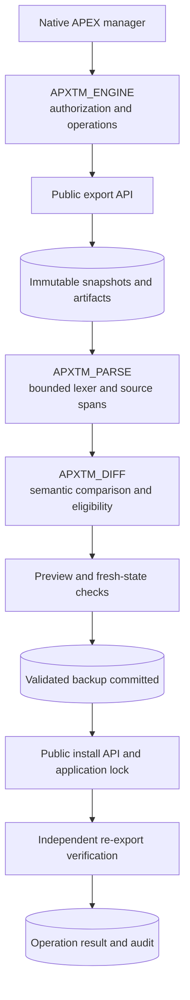

# APEX Theme Manager

**Snapshot. Compare. Recover.**

An original native Oracle APEX and PL/SQL application for definition snapshots,
semantic layout comparisons and controlled recovery of compatible attributes.
It applies selected values to the current application definition, with a preview,
validated backup and independent verification.

> **Development snapshot — beta release pending.** The database engine has
> verified laboratory results on exact APEX 26.2.0. Native browser workflow,
> recovery-availability fixes and final release checks are still in progress.
> Wait for the tagged beta before evaluating installation. No release, article
> or demonstration video is announced by this commit.

## What it does

- Captures complete SQL application definitions as UTF-8 ZIP artifacts, with
  provenance, source fingerprints, archive hashes and integrity validation.
- Compares pages, regions, items, buttons and available theme/template context.
  Difference classification, recovery eligibility and operation outcome are
  separate values.
- Recovers selected or all eligible numeric grid positions/spans and supported
  row/field flags **explicitly present in both definitions**.
- Binds a preview to an immutable selection, target state, actor and expiring
  single-use token. Later application edits invalidate the operation.
- Persists a validated definition backup before importing, then independently
  re-exports the target and verifies the complete normalized source fingerprint.
- Provides a separate full-definition restore workflow, with stronger authority
  and confirmation. Snapshot/current ACL assignment state must agree; an ACL
  mismatch requires manual review rather than an automatic reset.

Changed template references, template options and theme defaults are
**detection-only**. Missing inherited definitions become `NO_MATCH`; duplicate
template type/name/class identities become `AMBIGUOUS`. Absent parameters,
unsupported expressions and uncertain matches are not automatically repaired.
When a default true row flag disappears from SQL export, it can be reported as
`DROPPED` and left for review. **Fix All Eligible does not mean every difference.**

Snapshots contain application definitions. They do not back up runtime table
data, workspace users, credentials or external dependencies. The supplied sample
uses controlled synthetic layout edits authored in APEXlang; it does not claim
to reproduce an Oracle theme-switch defect.

## Architecture

The manager has eight functional native APEX pages plus APEX Accounts login.
The runtime needs Oracle Database and APEX with their existing web endpoint;
**no Node.js or Python runtime service is required**.

Only the generated `Exported By` comment is normalized for the source
fingerprint, to permit comparison across authenticated actors. Other exported
source remains significant; the ZIP archive hash checks the exact stored bytes.
See the [design](docs/architecture/design.md),
[public API research](docs/architecture/public-api-research.md) and
[observed transaction boundaries](docs/architecture/transactions.md).

## Before installation

Oracle's generated SQL export warns that modifying it is unsupported. This
beta's bounded transformer is independently tested project code; using public
export/import APIs does not make an edited export an Oracle-supported recovery
contract. Evaluate it on disposable applications first.

The distributed manager export declares **Modify Other Applications** (`O`).
That is workspace-wide APEX authority, broader than the manager's target
registry. Use a dedicated trusted development workspace and parsing schema.
Targets must belong to the configured workspace and use that parsing schema.

APXTM starts with `modification_policy=DISABLED`, no principals and no registered
targets. The direct database owner explicitly configures the manager, grants
named `DB:<OWNER>` / `APEX:<USER>` roles, registers targets, and separately enables
development recovery for a particular application. Runtime users cannot register
targets or grant themselves access. The manager excludes itself as a target.

READER, RECOVERER and RESTORER permissions complement APEX authentication and
server-side checks. Database owners, DBAs and anyone able to alter the manager
remain outside this application-level boundary. Read the
[threat model](docs/security/threat-model.md) and
[access-control guide](docs/security/access-control.md) before accepting import
authority.

An application import can commit and fail partially. **There is no atomic
rollback guarantee.** Keep independent trusted backups and coordinate a quiet
maintenance window. Public application locks constrain other users' App Builder
edits; they cannot exclude the lock owner, DBAs or external import scripts.

## Install and try the synthetic workflow

Follow the [complete installation guide](docs/installation/README.md). It covers
the existing workspace/schema, tablespace quota and ordinary schema privileges.
A DBA must separately review the required direct `DBMS_CRYPTO` execute grant;
the installer does not issue privileged grants.

Use SQL*Plus 23.26.3 for the verified administration flow. SQLcl 26.3 installed
the core twice successfully, but its guarded `configure.sql` invocation printed
`WHENEVER` help and exited with status 0 without configuring the database.
Do not remove protective handlers; see the
[client distinction](docs/installation/README.md#verified-sql-client-distinction).
SQLcl remains the APEXlang authoring tool.

1. In a fresh direct owner connection, run `@installer/install.sql`.
2. Import the manager with `installer/install_apex.sql` and explicit destination
   workspace/application binds. Complete the import and reconnect in SQL*Plus,
   then invoke `installer/configure.sql` with the existing manager and admin.
3. Import the [original two-page sample](samples/layout-lab/README.md), register
   only that target through the owner script, and capture/compare while recovery
   remains disabled.
4. Explicitly enable that development target. Preview one eligible grid value,
   confirm its actual application ID, inspect the backup and verified result,
   then compare again before using all remaining eligible values.
5. Exercise the separate restore preview and confirmation only with compatible
   ACL assignment state. Inspect the application's actual resulting definition.

No schema, workspace, app ID, service name or password is built into the portable
installer's destination configuration. Default IDs in generated SQL filenames
identify source artifacts; the public import context chooses the destination.
Developer browser helpers have a narrower original-laboratory scope.

## Documentation and verification

- [Compatibility and limits](docs/compatibility.md)
- [Test setup, commands and evidence](docs/testing/README.md)
- [Native application and page map](apex/README.md)
- [Synthetic fixture and reproduction](samples/layout-lab/README.md)
- [Upgrades, failed imports, retention and uninstall](docs/installation/maintenance.md)
- [Changelog](CHANGELOG.md), [contributing](CONTRIBUTING.md) and [private security reporting](SECURITY.md)

Test counts and release status belong in the final verification report. Package
compilation alone is not an integration result. No APEX 24.2 environment was
available, and no compatibility claim is made for it or other versions.

There is no automatic retention deletion. Snapshot retirement requires RESTORE
authority and typed confirmation; provenance foreign keys prevent deleting
referenced history. Uninstall defaults to refusal and requires exact typed
owner consent to remove only the fixed APXTM object set.

## License and provenance

An independent B2DEV TECH community project, developed from original source,
public Oracle documentation and synthetic applications. The original code is
[Apache-2.0](LICENSE). Oracle APEX, generated Universal Theme components and other
third-party material retain their applicable terms and notices. This project is
not affiliated with or endorsed by Oracle.
