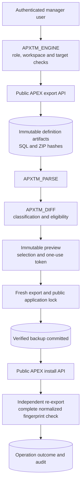

A page layout can be described in a few small values: a region spans six columns,
an item starts at column seven, a button occupies three. Recovering those values
becomes harder when an application has continued to change. Reimporting an old
application would also replace work that has nothing to do with the layout.

I built APEX Theme Manager to explore a narrower operation: keep the current
application, compare its definition with an earlier snapshot, and recover only
attributes whose identity and transformation can be established.

The demonstration uses controlled layout changes authored in APEXlang and
deployed with SQLcl. It tests recovery from known changes; it is not evidence of
a defect caused by switching an APEX theme.

## Where the native theme workflow fits

APEX already provides the normal appearance-management tools. Theme Roller
edits a theme style; template options apply declarative CSS modifiers to chosen
templates. Those operations differ from moving an application to another theme.
[Oracle's theme overview](https://docs.oracle.com/en/database/oracle/apex/26.2/htmdb/theme-templates.html)
describes their roles.

The [Switch Theme Wizard](https://docs.oracle.com/en/database/oracle/apex/26.2/htmdb/switching-themes.html)
maps component templates using type/class information, presents ambiguous
mappings for review and can block an incompatible switch. Back up or copy the
application before using it. A subscribed theme has another lifecycle: Verify
checks its relationship with the master, and Refresh brings subscribed metadata
into sync. Oracle documents local template/style copies for customization while
retaining the master subscription.
[Managing Theme Subscriptions](https://docs.oracle.com/en/database/oracle/apex/26.2/htmdb/managing-theme-subscriptions.html)
explains those choices; local copies are independent of the master's refresh.

Use those native workflows for theme management. My project explores inspecting
definition differences and recovering a small, independently tested subset of
layout values afterwards. It does not establish safe automatic cross-theme
template equivalence.

## What runs in this lab

The laboratory runs on one Windows machine with Oracle AI Database 26ai Free
23.26.3.0.0 and APEX 26.2.0. A dedicated parsing schema contains the original
PL/SQL packages and a native Universal Theme administration application. Node.js
and Playwright support development and testing; neither is a runtime service.

The synthetic target, APXTM Layout Lab, has two pages, **Project Desk** and
**Review Board**, with six item fields, regions and buttons. Its baseline export
contained 112,448 CLOB characters, compressed to a 46,353-byte ZIP, with 23
components recognized by the parser. Those are measurements of this fixture,
not a capacity limit or a representative application size.

APEX Theme Manager is an independent B2DEV TECH community project. Its original
source is licensed under Apache-2.0. Oracle APEX and generated Universal Theme
material retain their own applicable terms and notices.

[](/images/articles/apxtm/manager-overview.png)

*Figure 1. The manager and its explicitly registered development target.*

## Three packages, one privileged workflow

The implementation separates lexical parsing, semantic comparison and operations:

- `APXTM_PARSE` reads a bounded subset of generated SQL and records component
  identity, scalar values and source positions.
- `APXTM_DIFF` compares those semantic values and classifies eligibility.
- `APXTM_ENGINE` owns authorization, snapshots, previews, backups, imports and
  independent verification.

The APEX interface calls the engine. Hiding an Apply button cannot authorize an
operation, and a submitted application ID cannot register a new target.



*The recovery path. A normal return from the install API is followed by another
export before the engine records VERIFIED.*

## A snapshot has a precise boundary

A snapshot stores an application definition. It does not back up table rows,
workspace users, credentials or an external service. Supporting-object
installation is excluded from recovery.

The capture uses a complete, single-file SQL export. This is the relevant call
from the engine:

```sql title="database/packages/apxtm_engine.pkb — live_export excerpt"
    f:=apex_export.get_application(p_application_id=>p_app,p_type=>'SQL',p_split=>false,
      p_with_date=>false,p_with_original_ids=>false,p_with_no_subscriptions=>false,
      p_with_audit_info=>null,p_with_supporting_objects=>'N',p_with_acl_assignments=>true,
      p_with_ir_public_reports=>true,p_with_ir_private_reports=>true,
      p_with_ir_notifications=>true,p_with_translations=>true);
    if f.count!=1 then raise_application_error(-20026,'Expected one SQL export');end if;
    canonicalize_exporter(f(1).contents);
```

Current IDs and subscription references are preserved. Export dates and audit
identities are omitted so that those optional fields do not become differences.
ACL assignments, saved reports, notifications and translations are explicitly
requested because a full import must preserve more than the grid attributes
being repaired. The resulting definitions require confidential handling.
The engine validates identity through `APEX_APPLICATION_INSTALL.GET_INFO`,
stores source and archive SHA-256 hashes, and uses `APEX_EXPORT.ZIP`/`UNZIP` for
UTF-8 transport. Before storage, a new capture also compares exported page,
region, item and button identity sets with public live metadata. A historical
snapshot is validated against its stored provenance, not today's component set.
Identical definitions can share one stored artifact.

Cross-actor testing exposed a changing generated `Exported By` comment. I now
normalize that one recognized header line before storage/fingerprinting; the
actual actor remains in immutable snapshot and audit records. Other source is
not discarded to make hashes agree. Archive hashes check the stored ZIP bytes.

The format is version-specific. APEX 26.2 documents `SQL` and `APEXLANG` export
types; the 24.2 reference documents `APPLICATION_SOURCE`. The current engine
requires exact APEX 26.2.0. Changing a type name would not establish compatibility
with another release.

## Parsing enough to make a small change

Generated exports are executable SQL. Searching for a parameter name and
replacing the next number would also find text inside comments, SQL strings or
application code.

:::warning[Oracle support boundary]
The [Oracle-generated SQL header](https://github.com/B2DEV-TECH/apx-theme-manager/blob/main/apex/f104.sql)
warns that modifying the file is unsupported by Oracle and may produce
unexpected application or instance behavior. APXTM is an independent beta with
its own bounded transformer and tests. Calling public export/install APIs does
not make edited SQL artifacts an Oracle-supported transformation contract.
:::

The parser recognizes strings, escaped quotes, alternative quoting, comments,
nested parentheses and named parameters. It records character positions in the
CLOB and rejects unsupported expressions for transformation. Internal import
package names inside an Oracle-generated export are parsed as data; the project
does not call those internal packages directly.

A patch replaces a validated scalar span in the freshly exported current
definition. Everything outside those spans must remain identical. This lets a
selected layout repair preserve the current application's other source, rather
than reconstructing its components from an old definition.

The allowlist is deliberately small: recognized numeric grid positions/spans
and supported row/field booleans, explicitly present in both definitions.
Missing parameters, unknown expressions and uncertain identities remain outside
automatic recovery.

Final review exposed a gap in my hand-built models: actual 26.2 items use
`p_item_plug_id`; buttons use `p_button_template_id`; regions emit
`p_region_template_options` and `p_plug_item_display_point`. Missing those names
lost parent or detection context. I reproduced the failures before fixing them,
retained legacy aliases, and added an integration check comparing every exported
item parent with live public metadata. Passing modeled syntax was insufficient.

## A difference is not permission to repair

The controlled fixture produced fourteen differences: twelve eligible numeric grid
changes and two omitted row flags. A few examples show the distinction:

| Component / property | Baseline | Changed export | Classification | Eligible |
|---|---|---|---|---|
| `P1_PROJECT` / `p_colspan` | 6 | 12 | CHANGED | Yes |
| `P1_EMAIL` / `p_grid_column` | 7 | 1 | CHANGED | Yes |
| Project brief / region grid span | 6 | 8 | CHANGED | Yes |
| `P2_SUMMARY` / `p_colspan` | 6 | 9 | CHANGED | Yes |
| `P1_EMAIL` / `p_begin_on_new_line` | N | absent | DROPPED | No |

That last row was useful. In this export, setting a row flag to its default true
value removed the explicit parameter. The engine can report that the baseline's
parameter disappeared; it cannot recover an explicit value by replacing a span
that no longer exists. It leaves the difference for review.

Consequently, **Fix All Eligible** means all eligible attributes. In the test,
the remaining grid differences were recovered, while the two DROPPED row flags
remained outside that operation. Full definition restore is a separate action.

Actual rendering caught a flaw in my first changed fixture: individually valid
scalars produced overlapping regions/items. I corrected the Contact region's
column from 7 to 9 and `P2_STATUS` from 7 to 10. The transformer now validates the
recognized twelve-column plan, rejecting overflow and same-row/sibling overlap.
Position and span can be coupled; an unsafe selection is refused even when each
value is bounded. Mixed item/BODY-button rows remain manual, even safe coupled
rows; only known numeric trailing buttons with new-row/new-column behavior
are supported. This is not a general proof of responsive HTML/CSS.

[](/images/articles/apxtm/sample-baseline.png)

*Figure 2. Project Desk at the captured baseline.*

[](/images/articles/apxtm/sample-changed.png)

*Figure 3. Controlled APEXlang-authored layout changes on the same synthetic page.*

[](/images/articles/apxtm/comparison.png)

*Figure 4. Semantic differences distinguish eligible grid values from omitted row flags.*

### Why template names are insufficient

A template ID or familiar name does not establish cross-theme equivalence.
Missing definitions become `NO_MATCH`; duplicate type/name/class combinations
become `AMBIGUOUS` in the pure unit models. Actual inherited Universal Theme
bodies were absent even with `p_with_no_subscriptions=>true`. Those modeled
name/class rules do not certify a live cross-theme mapping. Template references,
options and theme defaults remain detection-only.

The first theme-context digest also mistook `p_files_version`, a generated cache
counter changed by APEXlang import, for theme drift. I exclude only that span
from the **THEME context digest**; the complete artifact/freshness SHA retains
it. This removed false positives while retaining the real layout changes.

The real export expresses the active theme in `wwv_imp_workspace.create_flow`,
with `p_id=>wwv_flow.g_flow_id` and `p_theme_id=>42`. A test changes that
application parameter from 42 to 43 in a copy of the complete exported text and
checks detection. It does not import another theme. A separate test detects a
template definition changed under the same ID.

## Preview is bound to a particular application state

A comparison binds the baseline to an exact current export. Preview records an
immutable selection and proposed artifact, with an expiring, single-use token.
It does not modify the application.

Apply checks the actor and target again, verifies the token and typed application
confirmation, and claims the operation. It checks for an existing developer lock,
takes the public APEX application lock, exports again and compares the current
fingerprint. A changed application invalidates the operation.

Before import, the engine stores and validates a definition backup, then commits
the backup and operation state. For recovery it also regenerates the allowlisted
patch and checks that its hash equals the approved artifact. A second freshness
check precedes installation.

The public install context specifies the existing workspace, application and
parsing schema. Recovery does not generate new component IDs or a new offset.
After installation, the engine re-exports independently and requires the
**complete normalized SQL fingerprint** to match the approved artifact. Selected values
alone would be an incomplete success check.

[](/images/articles/apxtm/recovery-preview.png)

*Figure 5. Review the selected scalar, target and proposed definition before apply.*

[](/images/articles/apxtm/recovery-verified.png)

*Figure 6. The verified operation retains its durable pre-import backup.*

## The transaction problem appeared at import

I tested `GET_APPLICATION` after pending DML. It succeeded in this environment;
the suspected `ORA-01453` was not reproduced. That matters because a plausible
explanation is not a result.

`APEX_APPLICATION_INSTALL.INSTALL` returned with metadata DML still pending.
Inspection showed TM and TX locks, and committing the connection that owned the
synthetic fixture import cleared them. Starting autonomous recovery from that
same importing connection before finishing its parent transaction produced
`ORA-00060` at the public application-lock operation.

The implementation now makes ownership explicit. Snapshot, comparison and
recovery requests use autonomous boundaries; export has its own boundary without
preceding engine DML. The engine commits the import it owns before independently
re-exporting the durable definition:

```sql title="database/packages/apxtm_engine.pkb — import and independent check"
    apex_application_install.install(p_source=>proposed_files,p_overwrite_existing=>true);
    -- INSTALL leaves metadata DML pending on the tested release. This autonomous
    -- operation owns the import, so complete that boundary before independent
    -- export. This does not commit the caller or promise atomic rollback.
    commit;
    after_files:=live_export(r.application_id);
    if source_hash(after_files(1).contents)!=proposed_hash then
      raise_application_error(-20030,'Post-import export does not exactly match the approved artifact; inspect the backup and audit');end if;
```

This commit does not commit the caller's unrelated business DML. The snapshot
test uses a second connection to check that pending caller changes remain
invisible while the snapshot is durable. It is evidence for that tested path,
not a reason to call recovery while holding application metadata locks in a
parent transaction. Developer scripts should complete their own import and use
a fresh session.

There is no atomic rollback promise. A deliberately invalid synthetic import
raised `ORA-20987`: the operation was FAILED, its durable backup validated and the
application remained present. An explicit owner reimport recovered it. That is
one failure path, not proof of all partial-import behavior. FAILED or interrupted
APPLYING operations require inspecting the actual application, backup and audit.

### The restore check caught retained ACL state

A preservation test added an ACL assignment after a snapshot, then tried full
restore. Native APEX installation retained the added assignment. The complete
post-import SHA did not match the approved artifact, so APXTM correctly recorded
FAILED with its durable backup instead of claiming restoration.

The safer boundary is earlier rejection. Restore preview and apply now compare
exported ACL role/assignment state and reject a mismatch with `ORA-20031` for
manual review. Positive preservation and negative rejection tests pass. A full
definition restore therefore requires compatible ACL state; it does not promise
to roll back runtime access assignments.

## What the tests establish

The [recorded verification report](https://github.com/B2DEV-TECH/apx-theme-manager/blob/main/docs/testing/verification.md)
for October 20 records **20 passing integration checks**, **26 real PL/SQL test
blocks** (16 parser, nine semantic, one security), **12 negative checks**,
**20 independent history checks**, **16 main native browser checks** and
**10 browser history checks**. Their scope matters more than a combined count:

| Area | Observed in the synthetic lab |
|---|---|
| Capture | Durable validated ZIP/source, deduplicated identical exports, pending caller DML not committed by snapshot |
| Comparison | Fourteen layout differences, twelve eligible; cache-counter noise excluded only from theme context; active-theme text and same-ID template changes detected |
| Selected recovery | Preview leaves the target unchanged; wrong confirmation is rejected; apply creates a validated backup and verifies the whole export |
| Remaining eligible recovery / compatible restore | Both reach VERIFIED after the normalized complete export matches the approved artifact; incompatible ACL state is rejected |
| Rejection paths | Consumed/expired tokens, stale edits, second stale preview preserving prior FIXED outcomes, wrong application/principal/workspace, corrupted archives and immutable metadata changes |
| Concurrent sessions | Two fresh database sessions produced one VERIFIED operation and one unique-constraint rejection; the public developer lock was released |
| Native browser | Both sample pages rendered at four states; three downloaded ZIPs matched stored hashes; two tabs kept their reviewed operation; zero JavaScript errors |

A separate clean workspace exercised install/reinstall, SQL*Plus configuration,
read-only capture, selected recovery on a different destination application ID,
the SQL suites and cross-actor identity. Removal consent tests preserved an
unrelated sentinel object. A fresh-session test also exposed an unset APEX
security-group context; it is now initialized from trusted configuration after
authorization.

`GET_APPLICATION` persisted a snapshot, yet the runtime HTTP response was empty.
I isolated that behavior and changed the native full-POST
flow to use public `APEX_UTIL.REDIRECT_URL` and `APEX_PAGE.GET_URL` after success
or rejection. The browser verified HTTP 302 followed by a fresh GET and protected
notices. No JSON-preservation workaround was needed.

History reads now have separate authorization from live operations. Authorized
users can download stored snapshots, proposals and backups when a target is
absent or its alias changes; capture, comparison and recovery still reject that
target. Recovery evidence should not disappear with the application it protects.
The separate native history run verified six hash-matching ZIP downloads after
alias change and actual target removal, then exact owner restoration.

This is still one host and APEX release, with one observed two-session race;
it does not establish exhaustive concurrency or partial-failure coverage.
The browser scenario took 162.316 seconds including navigation, validation and
queries, not API-only work. The edited recording below has separate reading
pauses and is not a performance benchmark.

## Reproducing the experiment

Start with a disposable workspace and dedicated parsing schema. Review the
[installation guide](https://github.com/B2DEV-TECH/apx-theme-manager/blob/main/docs/installation/README.md)
and [threat model](https://github.com/B2DEV-TECH/apx-theme-manager/blob/main/docs/security/threat-model.md)
before importing the manager. A DBA must separately review the direct
`DBMS_CRYPTO` execute grant; the installer does not grant powerful privileges.

1. Install the core in SQL*Plus using `installer/install.sql`. Import
   the manager with the supplied workspace/application binds, reconnect, then
   configure the existing manager and administrator explicitly.
2. Build/import the original sample using
   [its reproduction instructions](https://github.com/B2DEV-TECH/apx-theme-manager/tree/main/samples/layout-lab).
   Register only that target. Capture a baseline while recovery remains disabled.
3. Apply the separately authored changed fixture, compare it with the baseline,
   and inspect both eligible and ineligible rows.
4. Explicitly enable development recovery for that target. Preview one grid
   value, confirm the actual application ID, inspect the backup and verified
   result, then compare again before trying all remaining eligible values.
5. With matching ACL role/assignment state, use the separate restore
   preview/confirmation and independently inspect the result.

SQLcl 26.3 installed the core twice, but its guarded configuration invocation
printed `WHENEVER` help and exited 0 without applying configuration. The same
script succeeded in SQL*Plus 23.26.3. Use SQL*Plus for administration, retain the
protective handlers, and check database postconditions; a fresh connection alone
does not resolve that client issue.

Development tooling can run the published tests:

```bash title="Disposable lab only — integration overwrites the guarded synthetic target"
npm ci
npm test -- tests/parser.sql tests/semantic.sql tests/security.sql
node tests/integration.mjs --disposable-lab
node tests/negative.mjs --disposable-lab
```

Configure credentials only in the ignored local lab configuration described by
the contribution guide. Inspect the integration guard and fixture identity
before running it. Do not point it at an application containing real work.

<figure>
<video controls playsinline preload="metadata" poster="/images/articles/apxtm/demo-thumbnail.png" aria-label="Recorded synthetic Oracle APEX layout recovery workflow" style="aspect-ratio:4/3;width:100%;border:1px solid var(--border-subtle);border-radius:var(--radius-card);background:#000">
<source src="https://b2dev.tech/media/videos/apxtm/v0.1.0-beta/apex-theme-manager-demo.mp4" type="video/mp4">
<track kind="captions" src="https://b2dev.tech/media/videos/apxtm/v0.1.0-beta/demo.en.vtt" srclang="en" label="English">
Your browser cannot play this video. <a href="https://b2dev.tech/media/videos/apxtm/v0.1.0-beta/apex-theme-manager-demo.mp4">Download the MP4</a>.
</video>
<figcaption>3:59.685 (239.685 seconds), nine chapters and 23 English caption cues. Actual automated browser footage, edited into chapters with labeled reading pauses and unchanged runtime screenshots; no APEX screens were reconstructed. Narration uses a synthetic English Windows voice. Captions are burned into the video; the optional English track is not enabled by default. The pages and layout changes are synthetic, and no theme-switch defect is claimed.</figcaption>
</figure>

## The authority the manager needs

The distributed manager export explicitly declares **Modify Other Applications**
(`O`). Oracle defines that as authority over other applications in the workspace.
APXTM's own policy starts DISABLED, with empty principal and target registries,
but that platform capability is broader than its registry. Review it before
importing the manager into a trusted dedicated workspace.

The owner explicitly assigns READER, RECOVERER or RESTORER roles. Recovery also
requires a registered matching main application, development build status, an
enabled target flag and an existing lock developer. The manager excludes itself.
The engine derives the actor from authenticated APEX context or the direct
database owner session, rather than from a page item.

Public application locks coordinate other users' App Builder edits. They cannot
exclude the same lock owner, a DBA or independent import automation. A database
owner can also bypass APXTM tables and triggers. Arrange a quiet maintenance
window and protect exports as confidential executable artifacts. Hashes detect
integrity changes; they are not signatures against a privileged owner.

## Where this stops, and what comes next

Automatic recovery currently covers a tested scalar subset present in both
definitions. Missing row defaults, added/dropped components, ambiguous template
identity and cross-theme mappings require review. Split SQL exports, APEXlang
input parsing, other APEX versions, runtime data recovery and production-wide
deployment are outside this evidence.

Next are independent installations, broader adverse-case tests and specific
template-mapping fixtures. Each extension needs eligibility rules and failure tests.

If you want to contribute, start with a small synthetic application, its two
definitions and the exact difference you expect. A case the engine refuses can
be as useful as one it recovers.

## References

- [APEX Theme Manager — original source and reproduction files](https://github.com/B2DEV-TECH/apx-theme-manager).
- [Oracle APEX 26.2 — GET_APPLICATION](https://docs.oracle.com/en/database/oracle/apex/26.2/aeapi/GET_APPLICATION_Function.html), [ZIP](https://docs.oracle.com/en/database/oracle/apex/26.2/aeapi/ZIP-Function.html) and [UNZIP](https://docs.oracle.com/en/database/oracle/apex/26.2/aeapi/UNZIP-Function.html).
- [Oracle APEX 24.2 — GET_APPLICATION](https://docs.oracle.com/en/database/oracle/apex/24.2/aeapi/GET_APPLICATION_Function.html), for the documented format difference.
- [Oracle APEX 26.2 — GET_INFO](https://docs.oracle.com/en/database/oracle/apex/26.2/aeapi/GET_INFO-Function.html) and [INSTALL](https://docs.oracle.com/en/database/oracle/apex/26.2/aeapi/INSTALL-Procedure.html).
- [Oracle APEX 26.2 — new public locking APIs](https://docs.oracle.com/en/database/oracle/apex/26.2/htmrn/new-features.html) and [application lock behavior](https://docs.oracle.com/en/database/oracle/apex/26.2/htmdb/locking-and-unlocking-an-application.html).
- [Oracle APEX 26.2 — Runtime API Usage security attributes](https://docs.oracle.com/en/database/oracle/apex/26.2/htmdb/configuring-security-attributes.html).
- [Oracle APEX 26.2 — theme styles and template options](https://docs.oracle.com/en/database/oracle/apex/26.2/htmdb/theme-templates.html), [Switch Theme Wizard](https://docs.oracle.com/en/database/oracle/apex/26.2/htmdb/switching-themes.html) and [theme subscriptions](https://docs.oracle.com/en/database/oracle/apex/26.2/htmdb/managing-theme-subscriptions.html).
- [APXTM transaction observations and ownership boundaries](https://github.com/B2DEV-TECH/apx-theme-manager/blob/main/docs/architecture/transactions.md).
